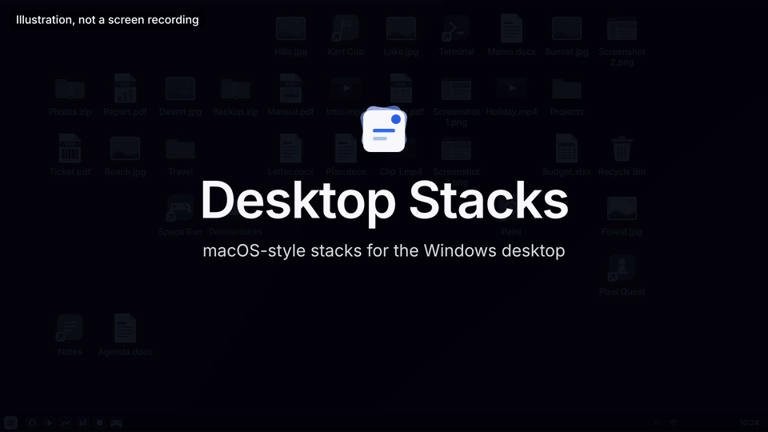

# Desktop Stacks

macOS-style desktop Stacks for Windows 10 and 11 (64-bit).

Desktop Stacks groups the files on your desktop into stacks by kind and shows
them along the right edge of the screen. It is a single portable executable of
about 600 KB: no installer, no runtime, no admin rights. It is written in Rust
using only the `windows` crate, and licensed under MIT.



*Illustration, not a screen recording.*

## Using it

1. Run `DesktopStacks.exe`. Its icon appears in the tray and your desktop
   files gather into stacks on the right edge.
2. Click a stack to open it, click again to close it. Scroll the mouse wheel
   over a closed stack to flip through its files.
3. Double-click, right-click and drag files as you always do.
4. To get the normal Windows desktop back, choose Pause or Exit from the tray
   icon. No file is ever moved.

## Status

This is an early release. So far it has been used on one PC only (Windows 11,
one desktop GPU). Expect rough edges. See [Known limits](#known-limits).

## Built with AI

This project was programmed with AI. The code was written by Claude, an AI
model made by Anthropic, directed and tested by the project owner, who is not
a professional programmer.

What that means for you:

- The code has gone through automated checks (`cargo clippy`, `cargo audit`,
  unit tests) and several independent AI code and security reviews.
- It has not yet had a line-by-line review by an experienced human developer.
- Everything is open: read the source, build it yourself, and judge it on what
  it does. Reviews and fixes from people who know Rust and the Windows API are
  especially welcome. See [Contributing](#contributing).

## What it does

- Groups desktop files into stacks by kind: Apps (shortcuts and programs),
  Games, Documents, PDF, Spreadsheets, Presentations, Images, Screenshots,
  Videos, Audio, Archives, Developer and Other. The stacks sit along the right
  edge.
- Game shortcuts get their own Games stack. A shortcut counts as a game when
  it points at a game store (Steam, Epic Games, Ubisoft, EA, Battle.net, GOG,
  Amazon Games) or at a game library folder (for example `steamapps`,
  `Riot Games`, `XboxGames`, `Rockstar Games`). See
  [Known limits](#known-limits).
- If a program lands in the wrong one of these two stacks, right-click it and
  choose "Move to Games stack" or "Move to Apps stack". The choice is
  remembered.
- A kind with a single file is shown as that file, not as a stack.
- Click a stack to expand it in place with an animation. Click again to
  collapse it.
- Mouse wheel over a closed stack flips through its files.
- When there are more icons than fit on the screen, the mouse wheel anywhere
  else slides the columns, and small arrows appear at the screen edge.
- Double-click opens an item.
- Right-click on an item shows the real Windows context menu. Right-click on
  a closed stack shows it for all files of the stack at once, so Delete or
  Cut there apply to every one of them (Windows still asks before deleting).
  Right-click on empty desktop shows the real desktop menu, plus Paste and
  Refresh.
- Drag files out to other apps. Drop files onto the desktop, onto folders or
  onto the Recycle Bin.
- Rename from the context menu.
- New, renamed and deleted files update live.
- Folders and system icons (This PC, Recycle Bin and the others enabled in
  Windows' desktop icon settings) are not stacked. Each keeps its own icon and
  they come right after the stacks. If you prefer, "Stack folders" in the tray
  menu gathers the folders into a Folders stack.

Tray icon menu:

| Item | What it does |
| --- | --- |
| Pause | Brings the normal Windows desktop back |
| Display | Chooses which monitor is used (default: primary) |
| Icon size | Small, Medium or Large |
| Stacks position | Right edge (default) or left edge of the screen |
| Stack folders | Gathers folders into a Folders stack |
| Dark background behind names | Makes file names readable on light wallpapers |
| Ctrl+Alt+D pauses and resumes | Optional keyboard shortcut, off by default |
| Language | Auto, Arabic or English. Auto means Arabic when Windows' display language is Arabic, otherwise English |
| Start with Windows | Starts the app at sign-in |
| Exit | Quits and restores the normal desktop |

## Install

1. Download `DesktopStacks.exe` from the [latest release](../../releases/latest).
2. Put it in its own folder, for example `%LOCALAPPDATA%\Programs\DesktopStacks`.
3. Run it.

The exe is not code-signed, so see [Verify your download](#verify-your-download)
and [SmartScreen](#smartscreen) below.

### Try it safely first

```
DesktopStacks.exe --dir C:\some\test\folder
```

This shows that folder instead of your Desktop folder, so you can try every
action on files that do not matter. The normal desktop icons are still hidden
while the app runs, and settings are shared with normal use. Exit brings the
icons back.

### Remove it

1. Untick "Start with Windows" in the tray menu.
2. Choose Exit from the tray menu.
3. Delete the exe and the folder `%LOCALAPPDATA%\DesktopStacks`.

If the desktop icons ever stay hidden: right-click the desktop, then
View > Show desktop icons.

## Verify your download

Each release exe is built by GitHub Actions from the public source (the
workflow is `.github/workflows/release.yml`). It is published together with a
SHA256 file and a build provenance attestation.

Check the hash in PowerShell and compare it with the SHA256 file of the
release:

```
Get-FileHash .\DesktopStacks.exe -Algorithm SHA256
```

Check the attestation with the GitHub CLI:

```
gh attestation verify DesktopStacks.exe --repo AMB22Ai/desktop-stacks
```

### SmartScreen

The exe is not code-signed. On first run, Windows SmartScreen shows "Windows
protected your PC". This is expected for unsigned software. Choose More info,
then Run anyway. If you prefer not to, build from source (below) and run your
own build.

## How it works

Windows draws the desktop inside Explorer and offers no API to group icons.
So the app:

1. Hides Explorer's icons with the same command as View > Show desktop icons.
2. Draws its own layer just above the wallpaper and below all windows.

The app never moves, renames, copies or deletes files on its own. It only
lists the Desktop and Public Desktop folders and displays them. The one case
where it opens a file itself is a program shortcut (`.lnk` or `.url`): it
reads at most the first 64 KB to see whether the shortcut is a game. Every file
action goes through the Windows shell, so menus, copy and move progress, Undo
and security prompts behave as they do in Explorer.

Pausing or exiting restores the normal desktop. A tiny second process (the
same exe, started with `--watchdog`) restores the icons if the app is killed or
crashes. They are also restored on sign-out.

### Performance design

- Draws on the GPU (Direct3D 11, Direct2D, DirectComposition) only when
  something changes. There is no render loop.
- File changes are event driven (`ReadDirectoryChangesW`). There is no polling.
- Drawing stops completely while a full-screen app or game covers its monitor.
- Runs at below-normal priority and with EcoQoS.

### Graphics

Any GPU from Direct3D feature level 9.1 works. The app falls back
automatically to Windows' software renderer (WARP) on remote desktop, in
virtual machines, with the basic display driver, when a GPU cannot hold a
screen-sized surface, or after the GPU fails. It recovers after driver updates
and sleep.

## Privacy and security

- There is no network code at all.
- There is no telemetry, and the app writes no logs and no crash dumps
  itself. If it ever crashes, Windows Error Reporting may record that, as for
  any program.
- The app saves only small text files in `%LOCALAPPDATA%\DesktopStacks`:
  `config.txt` (your tray menu settings), `icons-hidden.flag`, and, only if
  you move a program between Apps and Games by hand, `kinds.txt`, which holds
  the full path of each program you moved (at most 300).
- The optional Ctrl+Alt+D shortcut is registered with Windows as a single
  hotkey (`RegisterHotKey`). It is off until you tick it. The app does not
  see any other key you press. On keyboard layouts where AltGr+D types a
  character, leave it off: while it is on, Windows gives that key combination
  to this app.
- Registry: only if "Start with Windows" is ticked, it writes one value under
  `HKCU\Software\Microsoft\Windows\CurrentVersion\Run`. Hiding and showing
  the desktop icons uses Explorer's own "Show desktop icons" switch, which
  Explorer remembers; if Explorer does not answer when the icons must come
  back, the app sets Explorer's `HideIcons` value to 0 itself.
- To fill the Games stack, the app reads the start of `.lnk` and `.url`
  shortcut files on the desktop and searches it for known game store and game
  library names. This happens on your PC only. The content is not parsed, kept
  or sent anywhere; only the yes or no answer is held in memory.
- Apart from `kinds.txt` above, nothing about your files is stored. Windows
  may keep thumbnails in its own thumbnail cache, as it does for Explorer.
- The exe's import table contains no networking, keyboard-hook, screen-capture
  or process-injection APIs. Two system facilities it does use: a window
  event hook (`SetWinEventHook`) that only reports when the foreground window
  changes, to know when a full-screen app covers the screen, and
  `OpenProcess` with wait-only rights, so the watchdog can tell when the app
  has ended.
- DLL planting: a DLL file dropped next to the exe is not loaded. The exe
  links only to system DLLs that Windows takes from System32 whatever sits in
  the exe's folder (KnownDLLs, API sets and `bcryptprimitives.dll`), it loads
  the graphics libraries itself, at run time, from System32 only
  (`SetDefaultDllDirectories` and `LOAD_LIBRARY_SEARCH_SYSTEM32`), and it has a
  built-in manifest, so a `DesktopStacks.exe.manifest` file next to it is
  ignored. `tools/check_imports.py` enforces this at build time and
  `tools/planting_test.ps1` tests it with about 40 fake DLLs. So far this was
  tested on one PC (Windows 11, build 26200).
- In file name labels, direction-override characters and the common invisible
  characters are removed, so a name cannot disguise its extension. Opening a
  file always uses its real path, never the label.
- Dependencies are only the `windows-*` crates plus build-time proc-macro
  crates. `cargo audit` was clean at release time.

Same exposure as Explorer, by design:

- Third-party shell extensions (icon and context-menu handlers) load inside
  the app, as they do in any file manager.
- Shortcut icons that point to network shares are fetched the way Explorer
  fetches them, which can make Windows sign in to that server.

To report a vulnerability, see [SECURITY.md](SECURITY.md).

## Known limits

- Early release, used on one PC only (Windows 11).
- Windows 10 and 11, 64-bit only. No Windows 7 or 8, and no 32-bit build. It
  should run on Windows 11 ARM through x64 emulation, but this is untested.
- No keyboard navigation and no screen-reader support yet.
- Touch cannot scroll or flip through a stack.
- Grouping is by kind only. There is no grouping by date or tag yet.
- At most 10,000 desktop items are shown, and the desktop folder is read on
  the app's main thread: a huge or very slow (network) desktop folder makes
  the first display slow.
- Games are recognised by where their shortcut points, so the result is a
  best effort. Stays in Apps: a game installed in an ordinary folder, a
  Microsoft Store game whose shortcut holds no file path, and a game `.exe`
  placed directly on the desktop. Lands in Games although it is not a game:
  launchers (Steam, Epic Games Launcher, the Xbox app) and other software
  installed through a game store, for example a tool bought on Steam.
- Stacks show on one monitor.
- Label text is white with a shadow, like Explorer. On very light wallpapers
  turn on "Dark background behind names" in the tray menu.
- The exe is not code-signed.

## Build from source

On Windows:

1. Install Rust (stable, MSVC toolchain).
2. Run `cargo build --release`.
3. The result is `target\release\desktop-stacks.exe`.

On Linux, cross-building:

```
rustup target add x86_64-pc-windows-gnu
# install mingw-w64 with your package manager
cargo build --release --target x86_64-pc-windows-gnu
python3 tools/check_imports.py target/x86_64-pc-windows-gnu/release/desktop-stacks.exe
```

The last step checks that the exe links only to protected system DLLs (see
[Privacy and security](#privacy-and-security)).

Tests: run `cargo test` on Windows.

## Source map

| File | Contents |
| --- | --- |
| `main.rs` | Window, input, state machine, watchdog |
| `desktop.rs` | Explorer integration, z-order, monitors |
| `model.rs` | Scan and classify files |
| `games.rs` | Tells game shortcuts from other program shortcuts |
| `layout.rs` | Grid, scrolling, animation |
| `render.rs` | Direct2D and DirectComposition drawing |
| `icons.rs` | Icon and thumbnail workers |
| `shell.rs` | Open, context menus, drag and drop, paste |
| `rename.rs` | Rename |
| `tray.rs` | Tray menu, settings, autostart |
| `i18n.rs` | English and Arabic text |
| `harden.rs` | DLL hardening (System32-only loading of the graphics libraries), DPI awareness |

## Contributing

Issues and pull requests are welcome. You are free to study, change and
build on this project (see [License](#license)). If you spot a mistake in the
code, a review comment or a small fix is as valuable as a new feature.

- Please keep the project dependency-light, with no network access and no
  telemetry.
- Before opening a pull request, run `cargo clippy --all-targets -- -D warnings`
  and `cargo test`.
- Bug reports should include your Windows version, your GPU and your display
  scaling.
- Security reports go through the process in [SECURITY.md](SECURITY.md), not
  through public issues.

## License

MIT. See [LICENSE](LICENSE).
